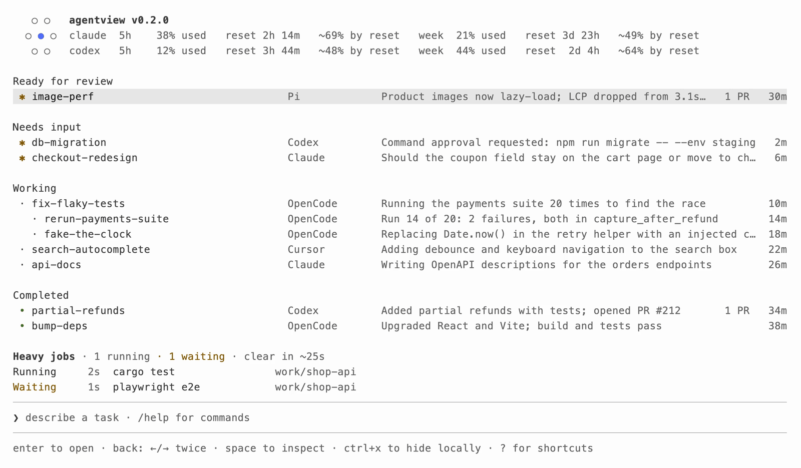

# agent-bouncer

Stop your computer from freezing when too many agents run at once.

Ten coding agents each start a build, a test suite or a headless browser, and
the machine runs out of RAM and grinds to a halt. agent-bouncer is a bouncer for
your CPU and RAM: it lets only as many heavy jobs in as the machine can take. The
rest wait in line, first come, first served.

```text
$ agent-bouncer status
slots 2/3 in use   free RAM 9.4 GB   swap 3.7 GB   CPU 41%

running
  slot 0   4m12s   2.1 GB   cargo test            ~/Code/agentview
  slot 1   0m48s   5.3 GB   pnpm playwright test  ~/Code/arca

waiting
  1.  0m31s   cargo clippy   ~/Code/agentview   (all slots are in use)
```

[agentview](https://github.com/moritzWa/agentview) lists the queue above its input and marks sessions stuck in line:



No daemon. It uses file locks and a small state folder, so nothing runs in the
background and a crashed job can never leak a slot.

## Use

```sh
agent-bouncer run --wait -- cargo test
agent-bouncer run --wait --weight 2 -- pnpm playwright test   # takes two slots
agent-bouncer run --max-wait 600 --label evals -- ./run-evals.sh
```

Without `--wait` it exits 75 straight away when busy. With `--wait` it queues.
`--max-wait SECONDS` gives up with 75 after that long (default 1800, 0 means
never).

```sh
agent-bouncer status          # slots, machine load, running jobs, the line
agent-bouncer stats --since 7d  # waits, refusals, heaviest commands
agent-bouncer log -n 50       # raw events as JSON lines
```

## What it does

- **First come, first served.** Waiters are admitted in arrival order. A waiter
  that dies leaves the line on its own.
- **Admission by what the machine has.** A job starts only when a slot is free,
  the CPU is not saturated, and free RAM stays above a floor even after every
  running job reaches the peak it usually hits. A small job slips in beside big
  ones; a heavy one waits for room. The estimate is the 90th percentile of past
  runs of the same kind of command (1.5 GB for one it has never seen). Free RAM
  and CPU are measured now, not from a one-minute load average that stays high
  after a job ends. A new job also gets a few seconds to ramp up before the
  next one starts beside it.
- **Cleans up after jobs.** Each job runs in its own process group. When it ends,
  whatever it left running (dev servers, headless browsers) is stopped.
  `--no-reap` turns that off.
- **Never kills a running job.** When RAM runs low it stops admitting new jobs. It
  does not kill or requeue one that is already running.
- **Measures itself.** Every wait, refusal and run goes into an event log, so
  "how often am I resource-bound?" has a number. `stats` gives you waits per day,
  what blocked them, and each command's peak RAM.
- **No deadlocks.** A job that calls `agent-bouncer` itself runs directly.

## Settings

| Variable | Default | Meaning |
| --- | --- | --- |
| `AGENT_BOUNCER_SLOTS` | cores / 3, between 2 and 8 | Most heavy jobs at once (RAM and CPU usually limit it first) |
| `AGENT_BOUNCER_MIN_FREE_GB` | 3 | Free RAM floor for admitting a job |
| `AGENT_BOUNCER_SETTLE_MS` | 3000 | Time a new job gets to ramp up before another starts beside it |
| `AGENT_BOUNCER_MAX_CPU` | 90 | Busy CPU percent above which no job is admitted (100 turns the check off) |
| `AGENT_BOUNCER_DIR` | `~/.local/state/agent-bouncer` | State and event log |

Exit codes: the job's own, 75 busy or wait limit passed, 64 bad usage, 127 cannot
run the command, 128+N when stopped by signal N.

## Install

```sh
curl -fsSL https://raw.githubusercontent.com/moritzWa/agent-bouncer/main/install.sh | bash
```

Or build it yourself: `cargo install --git https://github.com/moritzWa/agent-bouncer`.
macOS and Linux.

## License

MIT
