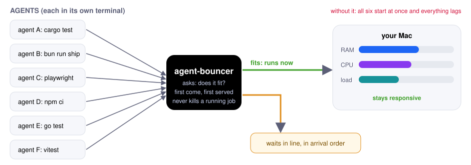

# agent-bouncer

Stop your computer from freezing when too many agents run at once.

Ten coding agents each start a build, a test suite or a headless browser, and
the machine runs out of RAM and grinds to a halt. agent-bouncer is a bouncer for
your CPU and RAM: it lets only as many heavy jobs in as the machine can take. The
rest wait in line, first come, first served.



**[How it works, with diagrams](https://moritzwa.github.io/agent-bouncer/how-it-works.html)**

```text
$ agent-bouncer status
2 running   cores 10/18 expected   free RAM 9.4 GB   swap 3.7 GB   CPU 41%

running
   4m12s   2.1 GB of ~2.4 GB   3.0 cores  cargo test            ~/Code/agentview
    48s    1.1 GB of ~5.3 GB   7.0 cores  pnpm playwright test  ~/Code/arca

waiting
  1.  0m31s   cargo build --release   ~/Code/agentview   (the running jobs are already expected to use all the CPU cores)
```

[agentview](https://github.com/moritzWa/agentview) lists the queue above its input and marks sessions stuck in line:


No daemon. It uses file locks and a small state folder, so nothing runs in the
background and a crashed job can never leak a lock.

## Use

```sh
agent-bouncer run --wait -- cargo test
agent-bouncer run --wait -- pnpm playwright test
agent-bouncer run --max-wait 600 --label evals -- ./run-evals.sh
```

Without `--wait` it exits 75 straight away when busy. With `--wait` it queues.
`--max-wait SECONDS` gives up with 75 after that long (default 1800, 0 means
never).

```sh
agent-bouncer status          # machine load, running jobs, the line
agent-bouncer predict -- cargo test   # what it expects a command to need
agent-bouncer predict --show -- cargo test   # exactly what the model would be sent
agent-bouncer doctor          # tests the model and key with a real call
agent-bouncer stats --since 7d  # waits, refusals, heaviest commands
agent-bouncer log -n 50       # raw events as JSON lines
```

## What it does

- **First come, first served.** Waiters are admitted in arrival order. A waiter
  that dies leaves the line on its own.
- **Admits by what a job needs, not a slot count.** A cheap model (Gemini Flash
  Lite via OpenRouter, about a second) predicts the job's peak RAM and cores from
  the closest past runs, which are measured for every job. A job starts when free
  RAM stays above a floor and the cores fit. Small jobs slip in beside big ones.
  With no key it falls back to past runs. Details in the
  [explainer](https://moritzwa.github.io/agent-bouncer/how-it-works.html).
- **Never kills a running job.** When the machine is full it stops admitting new
  jobs and nothing else.
- **Cleans up after jobs.** Each job runs in its own process group; leftover dev
  servers and headless browsers are stopped when it ends (`--no-reap` turns that
  off).
- **Measures itself.** Every wait, refusal and run goes into an event log;
  `stats` shows waits, what blocked them and each command's peak RAM.
- **No deadlocks.** A job that calls `agent-bouncer` itself runs directly.

## Settings

| Variable | Default | Meaning |
| --- | --- | --- |
| `AGENT_BOUNCER_MODEL` | `google/gemini-3.1-flash-lite` | OpenRouter model that predicts a job's RAM and cores (`off` uses past runs only) |
| `AGENT_BOUNCER_OPENROUTER_KEY` | | Key for it. Also read from `~/.config/agent-bouncer/openrouter-key`, then `OPENROUTER_API_KEY` |
| `AGENT_BOUNCER_MODEL_TIMEOUT` | 6 | Seconds to wait for the model before using past runs |
| `AGENT_BOUNCER_MAX_CORES` | 1.25 x cores | Cores the running jobs may be expected to use together |
| `AGENT_BOUNCER_SLOTS` | no limit | Optional hard cap on jobs at once; `--weight N` takes N of them |
| `AGENT_BOUNCER_MIN_FREE_GB` | 3 | Free RAM floor for admitting a job |
| `AGENT_BOUNCER_SETTLE_MS` | 2000 | Time a new job gets to ramp up before another starts beside it |
| `AGENT_BOUNCER_MIN_RUNNING` | 2 | Jobs that may always run together as far as CPU and load go, so a busy machine never leaves the line stuck behind one job (RAM and swap checks still apply) |
| `AGENT_BOUNCER_MAX_LOAD` | 1.5 | One-minute load average per core above which no job starts beside a running one (0 turns it off) |
| `AGENT_BOUNCER_MAX_SWAPOUT` | 25 | MB per second written to swap above which no job starts beside a running one: the Mac is short of RAM right now (0 turns it off) |
| `AGENT_BOUNCER_MAX_CPU` | 90 | Busy CPU percent above which no job is admitted (100 turns the check off) |
| `AGENT_BOUNCER_DIR` | `~/.local/state/agent-bouncer` | State and event log |

**Setup:** nothing to configure. If `OPENROUTER_API_KEY` is already in your
environment it is used; otherwise put a key in `~/.config/agent-bouncer/openrouter-key`.
Run `agent-bouncer doctor` to check it. With no key it predicts from past runs.

**Privacy:** with a key set, each job sends its command line, directory, the
package.json script it runs, machine load and the commands and peak numbers of a
few similar past runs to OpenRouter. `agent-bouncer predict --show -- <cmd>` prints it all. Set
`AGENT_BOUNCER_MODEL=off`, or leave the key unset, to keep everything on the machine.

Exit codes: the job's own, 75 busy or wait limit passed, 64 bad usage, 127 cannot
run the command, 128+N when stopped by signal N.

## Install

```sh
curl -fsSL https://raw.githubusercontent.com/moritzWa/agent-bouncer/main/install.sh | bash
```

Or build it yourself: `cargo install --git https://github.com/moritzWa/agent-bouncer`.
macOS and Linux.

## License

MIT
